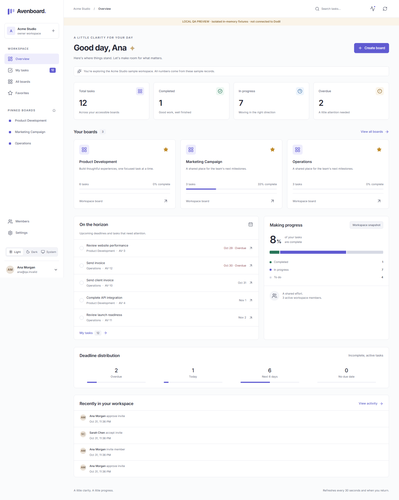
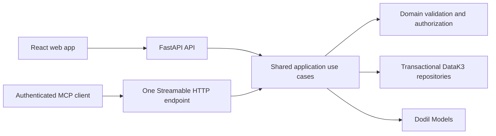

# Avenboard

A calm workspace for teams to turn plans into progress. Boards, tasks and an authenticated MCP endpoint share the same permissions and application services.

**Implementation status:** the local implementation is available; live Dodil deployment and a real fresh-organization remix are not yet verified. See [release evidence](docs/VERIFICATION.md) before treating this as a release.

## Preview

**Public dashboard preview:** [m-saad-1.github.io/avenboard](https://m-saad-1.github.io/avenboard/). It runs the actual React dashboard with a read-only, labeled sample workspace; GitHub Pages cannot host the API needed for sign-in and live data.

These are real browser captures of the **labeled local QA fixture**, not a deployed Dodil instance. Fixture accounts are never provisioned or packaged in production.



[Dark overview](docs/screenshots/desktop-dark.png) · [Board](docs/screenshots/desktop-board.png) · [Card details](docs/screenshots/desktop-card.png) · [Mobile](docs/screenshots/mobile-light.png) · [Tablet](docs/screenshots/tablet-dark.png)

## Features

- Multiple workspaces and boards; owner, member and viewer permissions; explicit private-board grants.
- Owner-managed, seven-day, single-use invitations; account approval when email ownership is not attested.
- Dynamic lists with explicit progress categories; versioned cards, assignments, calendar due dates and reusable labels.
- Pointer, touch and keyboard sorting; explicit movement controls; rollback and stale-edit handling.
- Overview metrics, deadline distribution, personal task groups, favorites, persisted theme preferences and activity.
- Editable ordered checklists; directed dependencies, cycle rejection, dependency map and transitive blocker queries.
- Four Dodil Models integrations: reviewable checklists, summaries, recommendations and semantic search.
- Opt-in Acme Studio sample workspace. Repeated sample setup reuses the owner's sample workspace without overwriting work.

Semantic search is deliberately disabled until the real 512-dimensional embedding/vector contract is verified. The UI reports this and keeps keyword search usable. Models errors never simulate successful AI output.

## Architecture



The original starter's domain/application/infrastructure/doors layout is retained. React builds into FastAPI's static directory and is served by the same Ignite app. [DESIGN.md](DESIGN.md) explains the decisions and trade-offs.

## Technology stack

Python 3.12, FastAPI, Pydantic, psycopg, the official MCP Python SDK; React, TypeScript, Vite, dnd-kit, Lucide icons and locally bundled Inter fonts. Dodil DataK3, appid, Models, Git CI and Ignite are the only production platform services.

Frontend versions are pinned in package-lock.json. Python direct dependencies are pinned in app/requirements.txt. No external database, authentication service, email provider or AI provider is used.

## Database design

[schema.sql](schema.sql) defines 19 explicit-primary-key tables. Every durable record lives in DataK3: users, workspaces, memberships, invitations, boards, board grants, lists, cards, labels, card-label links, checklist items, dependencies, activity, favorites, preferences, receipts, embedding jobs, embeddings and schema versions.

User identity is the trusted pool plus immutable subject. New business entities use UUIDs. Card numbers are allocated transactionally per workspace. Cards and parent boards carry versions. Mutation, ordering, receipt and activity writes commit together.

Relationships are validated and cleaned up in application transactions. The design does not depend on cascading foreign keys, triggers or blocking row locks. Conflict retries rerun the entire transaction up to three times. A stale client version remains a conflict.

Migration 001 adds ab_* tables without dropping or claiming the starter's old tables. Existing starter data is preserved, but **not automatically imported**: its email-based identities cannot safely be linked to genuine appid subjects. The approved starting point is a fresh remix. See [migration procedure](docs/MIGRATIONS.md).

## Authentication architecture

Ignite binds the destination appid pool and strips client-supplied gateway identity headers. The app requires pool-user context and configured DODIL_USER_POOL; platform service credentials cannot impersonate an application user. Production rejects DEV_USER.

Application roles are stored in DataK3 and are separate from appid platform roles. Owners manage boards and membership; members manage work; viewers read accessible work and may save their own preferences/favorites. Private boards require an explicit grant except for the owner.

An invitation token is hashed at rest. The gateway contract used here does not attest email verification, so acceptance records the authenticated subject and requires owner approval. It never grants membership merely because a user supplied an email address. Share invitation links manually; no email service is required.

## MCP connection

Use **https://YOUR_DEPLOYED_HOST/mcp** as a Streamable HTTP connector URL in Claude or ChatGPT. /mcp/ is a compatibility alias of the same service.

1. Deploy and complete browser sign-in configuration.
2. Add the connector URL in the client.
3. Complete appid sign-in with a genuine pool user.
4. If the client is pending, an organization administrator must inspect and approve it with `dodil appid client list <pool>` and the corresponding client approval command.
5. Run list_my_boards and show_board before selecting IDs or writing.

Connector-client approval is separate from browser callback registration. Both protected-resource metadata routes remain public; unauthenticated MCP calls return 401 with WWW-Authenticate.

Required tools: list_my_boards, show_board, list_my_cards, list_overdue, create_board, create_card, move_card, assign_card, update_card, add_label, generate_checklist, summarize_board.

Supporting tools: list_board_members, search_cards, list_blockers, save_checklist.

Identity never comes from tool arguments. Target assignees are checked for active membership and board access. Reuse operation_id only when retrying identical content. Refresh after a version conflict. Checklist generation is a preview; save_checklist is a separate operation after user review.

## Natural-language examples

| Request | Tool sequence |
|---|---|
| What tasks are assigned to me this week? | list_my_cards(period="this_week"); server computes the local Monday–Sunday week |
| Show me all overdue tasks. | list_overdue |
| Create a card called Send invoice in Doing on the Operations board. | list_my_boards, create_card; Doing is the seeded In Progress alias |
| Move card 12 to Done. | search_cards(workspace_id, card_number=12), show_board, move_card |
| Assign the website redesign task to Sarah. | search_cards, list_board_members, assign_card |
| Which tasks are blocking the launch? | search_cards, list_blockers with the launch card |
| Summarize the progress of the Operations board. | list_my_boards, summarize_board |
| Turn the homepage redesign task into a checklist. | search_cards, generate_checklist, review, save_checklist |

Disambiguate duplicate board/member/task names among authorized resources. Workspace card numbers are unique only within that workspace. These sequences have automated transport tests; live conversational verification with Claude/ChatGPT remains pending.

## Local development

Requirements: Python 3.12 and Node 24. From the repository root:

```sh
python -m venv .venv
# Activate the virtual environment using your shell.
python -m pip install -r requirements-dev.txt
python scripts/export_openapi.py
cd frontend
npm ci
npm run generate:types
npm run build
cd ..
python -m uvicorn tests.preview:app --host 127.0.0.1 --port 8080
```

The last command starts an explicitly marked **QA preview**, with isolated in-memory fixtures and a test Models adapter. It is loopback-only, resets when restarted, and is never included in the production image. http://127.0.0.1:8080 is a local preview, not a deployed app. Browser fixtures use qa.invalid identities solely to exercise permissions.

For frontend development run `npm run dev` in frontend while the QA server is running. Vite proxies /api to localhost:8080. For real integration, use a disposable Dodil test organization and genuine gateway sign-in; never manufacture production identity headers.

Brand name/mark are in frontend/src/branding.ts and ui.tsx. Colors and theme tokens are in tokens.css. Changing branding does not change IDs or business rules.

## Environment configuration

| Variable | Purpose |
|---|---|
| BUCKET | Destination remix's DataK3 bucket |
| PG_HOST / PG_PORT | Official DataK3 wire endpoint; default pg.uk-lon-1.dodil.io / 5432 |
| PG_SSLMODE | require by default; use verify-full with the platform CA when configured |
| DODIL_SERVICE_ACCOUNT_ID | Full generated service-account ID |
| DODIL_SERVICE_ACCOUNT_SECRET | Server-only CI secret reference |
| DODIL_USER_POOL | Destination organization/pool |
| MODELS_BASE | https://api.dodil.io/v1 |
| CHAT_MODEL | Candidate kimi-k2.6; verify availability live |
| EMBEDDING_MODEL | Candidate jina-embeddings-v4 |
| SEMANTIC_SEARCH_ENABLED | false until authenticated embedding/vector contract tests pass |
| APP_PUBLIC_URL | Optional canonical deployment origin |
| APPID_PUBLIC_URL | Optional appid issuer base; defaults to official appid host |

Do not put secrets in frontend variables, files committed to Git, logs or submission material.

## Automated testing

```sh
python -m pytest -q
python scripts/export_openapi.py
cd frontend
npm run generate:types
npm run build
npx playwright install chromium
npm run test:e2e
npm audit
```

Backend tests use repository/Models fakes and real MCP transport; they require no Dodil account. Browser tests run desktop/tablet/mobile Chromium, with pointer/touch/keyboard cases selected for the relevant device. They exercise real UI requests against test adapters. Screenshots can be regenerated with `node scripts/screenshots.mjs` against a clean preview instance. `node scripts/contrast.mjs` checks theme token contrast and `node scripts/performance.mjs` records clearly labeled local navigation samples.

Live tests are separately marked in tests/test_live_contracts.py. Set DODIL_CONTRACT_TESTS=1 and genuine **test-organization** service credentials; set TEST_APP_URL and TEST_POOL_USER_TOKEN for the gateway test. These tests perform schema setup and model calls and must never target an unapproved production bucket. Run `pytest -m live`. No live tests have been represented as passing when skipped.

## Deployment

The supported Dodil Git workflow checks Python, generated contracts, frontend build and browser tests before building the nonroot image. The repository-root Docker build uses app/Dockerfile; port is 8080. Startup applies/verifies additive migration 001 before serving.

Before pushing CI/CD changes run `dodil git ci verify . --repo <org>/avenboard` while authenticated to the destination organization. Resolve every error and account-dependent skipped check. The local unauthenticated invocation checks syntax only.

Dodil Git CI publishes a lowercase registry image and .dodil/deploy.yaml deploys only successful main checks. /healthz is liveness. Authenticated platform POST / opens DataK3 with the app's own credential and returns row counts per table. Verify actual sign-in and application operations as well as liveness.

## Remixing

The local implementation was prepared from official starter commit 2815f0bbc39ae589ff78be4dfcd87757e7cfe268. Cloud account access was not available during preparation. Do not push to the retained starter remote.

With the destination organization confirmed:

```text
dodil auth login --web
dodil git remix dodil/boards-challenge --to-org <org> --name avenboard
# Configure origin to the resulting repository; reconcile its starter history.
dodil git ci verify . --repo <org>/avenboard
# Publish the reviewed implementation to that origin.
dodil git remix check <org>/avenboard
dodil git remix plan <org>/avenboard --to-org <fresh-test-org>
```

Require VALID from the check. Then perform the actual remix into the fresh test organization and verify deployment, sign-in, persistence, all roles, Models and MCP. A plan or syntactically valid YAML is not evidence of a successful remix.

remix.yaml provisions the bucket/schema, appid pool, service account, bucket-scoped k3.editor and ignite.model-user grants, generated CI secrets and exact topics dodil-challenge and dodil-challenge-boards. Names derive from destination organization/repository. The repository slug must be at most 18 characters. Bucket/pool conflicts fail rather than silently attaching to unrelated data.

## Post-remix sign-in

Inspect deployment output and existing appid settings. Current Dodil releases may register the callback automatically; verify it rather than assume.

The required browser callback is:

```text
https://<deployed-host>/.dodil/auth/callback
```

If missing, read all existing settings first, merge this URI into allowed redirect URLs, and write the **complete preserved settings**. The CLI settings operation replaces settings. Preserve signup rules and every existing allowed URL. Confirm a real user can sign in; platform invocation alone does not test sign-in. See [official app authentication guidance](https://blog.dodil.io/library/app-authentication/).

## Security and operations

Authorization follows workspace → board → child relationships. Search, counts, activity, AI context and MCP use the same access boundaries. Assignment removal and private-access revocation are transactional. The sole owner cannot be removed or demoted.

CSRF protection requires same-origin requests and a custom write header. SQL values are parameterized, content is rendered as React text, the app sets CSP/frame/referrer headers, and service credentials remain server-side. Operational logs include route templates, status and duration, never task bodies or credentials. Production access logging is disabled to keep search terms out of URLs in logs.

Archives are reversible; restoring a parent preserves child archive flags. Deletion retains tombstones and audit history. Dependencies on deleted/archived work remain unresolved. Due dates are calendar dates in a validated workspace IANA timezone; timestamps are UTC. Past dates are allowed. No browser clock determines overdue status.

Embedding jobs persist leases and content versions in DataK3, recover on startup and perform bounded recovery during search. Requests to Models run outside database transactions. Suggestions never execute changes automatically.

Roll back to the previous successful Ignite image if necessary. Additive schema changes retain compatibility; do not drop tables as part of rollback. Inspect sanitized logs and platform self-check before reopening traffic.

## Known limitations and release blockers

- Destination/test organizations and authenticated Dodil access are still required. No public repository URL or verified live URL is claimed.
- Live gateway, DataK3 concurrency/SQL, Models envelopes/dimensions, container build, actual deployment and fresh remix must pass before release.
- Semantic search remains visibly unavailable until its live contract is enabled. QA AI output is explicitly a fixture.
- Workspace snapshots load accessible workspace data together; search and feeds paginate, but very large workspaces need incremental snapshot/board loading and measured DataK3 capacity testing.
- Refresh uses 30-second polling and focus refresh, paused while editing; it is not a realtime push service.
- Comments, attachments, email delivery and a separate notification inbox are outside this version. Activity is real recorded activity.
- Core operations, AI previews and test sequences are implemented; real owner/member/viewer and Sarah accounts must still be supplied for deployed demonstrations.

## Future improvements

Incremental board loading and server aggregates for large teams, event-based refresh, richer dependency graph layout, optional comments/attachments, notification preferences and connector recordings after live validation. Keep each extension within the same application authorization boundary.

## License and submission

MIT; original Dodil copyright retained. Inter and Lucide license notices are in [THIRD_PARTY.md](THIRD_PARTY.md).

[Submission worksheet](docs/SUBMISSION.md) records the URLs and evidence that must be filled only after verification. Partner-programme acceptance and Freelancer submission are separate user actions.
